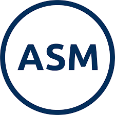
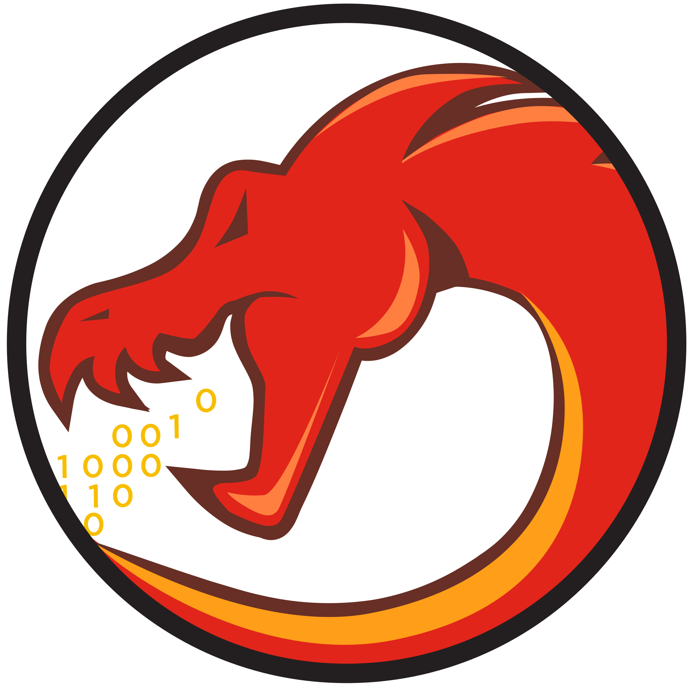
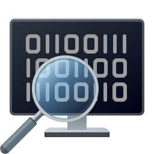

⠀⠀⠀⠀⠀⠀⠀⠀⠀⠀⠀⠀⠀⠀⠀⠀⠀⠀⢀⣀⣀⣀⣀⣀⣠⣼⠂⠀⠀⠀⠀⠙⣦⢀⠀⠀⠀⠀⠀⢶⣤⣀⣀⣀⣀⣀⡀⠀⠀⠀⠀⠀⠀⠀⠀⠀⠀⠀⠀⠀⠀⠀⠀⠀⠀
⠀⠀⠀⠀⠀⠀⠀⠀⠀⠀⠀⠀⠀⢀⣠⣴⣶⣿⣿⣿⣿⣿⣿⣿⣿⠷⢦⠀⣹⣶⣿⣦⣿⡘⣇⠀⠀⠀⢰⠾⣿⣿⣿⣟⣻⣿⣿⣿⣷⣦⣄⡀⠀⠀⠀⠀⠀⠀⠀⠀⠀⠀⠀⠀⠀
⠀⠀⠀⠀⠀⠀⠀⠀⠀⠀⢀⣤⣾⣿⣿⣿⣿⣿⣿⣿⣿⣿⡟⠀⠀⠀⠀⢺⣿⣿⣿⣿⣿⣿⣿⣆⠀⠀⠀⠀⠀⠀⢹⣿⣿⣿⣿⣿⣿⣿⣿⣿⣷⣦⡀⠀⠀⠀⠀⠀⠀⠀⠀⠀⠀
⠀⠀⠀⠀⠀⠀⠀⠀⢀⣴⢟⣥⣿⣿⣿⣿⣿⣿⣿⣿⣿⣿⡇⠀⠀⠀⠀⢻⣿⣿⡏⢹⣿⣿⣿⣿⠀⠀⠀⠀⠀⠀⠀⣿⣿⣿⣿⣿⣿⣿⣿⣿⣿⣮⣝⢷⣄⠀⠀⠀⠀⠀⠀⠀⠀
⠀⠀⠀⠀⠀⠀⠀⣴⣿⣿⣿⣿⣿⣿⣿⣿⣿⡿⢛⣿⣿⣿⡇⠀⠀⠀⠀⠛⣿⣿⣷⡀⠘⢿⣧⣻⡷⠀⠀⠀⠀⠀⠀⣿⣿⣿⣟⢿⣿⣿⣿⣿⣿⣿⣿⣿⣝⢧⡀⠀⠀⠀⠀⠀⠀
⠀⠀⠀⠀⠀⢠⣾⣿⠟⣡⣾⣿⣿⣧⣿⡿⣋⣴⣿⣿⣿⣿⣧⠀⠀⠀⠀⠀⢻⣿⣿⣿⣶⡄⠙⠛⠁⠀⠀⠀⠀⠀⢸⣿⣿⣿⣿⣷⣝⢻⣿⣟⣿⣿⣷⣮⡙⢿⣽⣆⠀⠀⠀⠀⠀
⠀⠀⠀⠀⢀⡿⢋⣴⣿⣿⣿⣿⣿⣼⣯⣾⣿⣿⡿⣻⣿⣿⣿⣦⠀⠀⠀⠀⢀⣹⣿⣿⣿⣿⣶⣤⠀⠀⠀⠀⠀⣰⣿⣿⣿⣿⠻⣿⣿⣿⣮⣿⣿⣿⣿⣿⣿⣦⡙⢿⣇⠀⠀⠀⠀
⠀⠀⠀⣠⡏⣰⣿⣿⡿⢿⣿⣿⣿⣿⣿⣿⡿⢋⣼⣿⣿⣿⣿⣿⣷⡤⠀⣠⣿⣿⣿⣿⣿⣿⣿⣿⣷⣄⠀⢠⣾⣿⣿⣿⣿⣿⣷⡜⢿⣿⣿⣿⣿⣿⣿⡿⠿⣿⣿⣦⡙⣦⠀⠀⠀
⠀⠀⣰⢿⣿⣿⠟⠋⣠⣾⣿⣿⣿⣿⣿⠛⢡⣾⡿⢻⣿⣿⣿⣿⣿⣿⣿⣿⡿⠋⠻⣿⡟⣿⣿⣿⠻⢿⣿⣿⣿⣿⣿⣿⣿⣟⠻⣿⣆⠙⢿⣿⣿⣿⣿⣿⣦⡈⠻⣿⣿⣟⣧⠀⠀
⠀⣰⢣⣿⡿⠃⣠⡾⠟⠁⠀⣸⣿⡟⠁⢀⣿⠋⢠⣿⡏⣿⣿⣿⣿⣿⢿⠁⢀⣠⣴⢿⣷⣿⣿⣿⠀⠀⠽⢻⣿⣿⣿⣿⡼⣿⡇⠈⢿⡆⠀⠻⣿⣧⠀⠈⠙⢿⣆⠈⠻⣿⣎⢧⠀
⠀⢣⣿⠟⢀⡼⠋⠀⠀⢀⣴⠿⠋⠀⠀⣾⡟⠀⢸⣿⠙⣿⠃⠘⢿⡟⠀⣰⢻⠟⠻⣿⣿⣿⣿⣿⣀⠀⠀⠘⣿⠋⠀⣿⡇⣿⡇⠀⠸⣿⡄⠀⠈⠻⣷⣄⠀⠀⠙⢷⡀⠙⣿⣆⠁
⢀⣿⡏⠀⡞⠁⢀⡠⠞⠋⠁⠀⠀⠀⠈⠉⠀⠀⠀⠿⠀⠈⠀⠀⠀⠀⠀⣿⣿⣰⣾⣿⣿⣿⣿⣿⣿⣤⠀⠀⠀⠀⠀⠉⠀⠸⠃⠀⠀⠈⠋⠀⠀⠀⠀⠙⠳⢤⣀⠀⠹⡄⠘⣿⡄
⣸⡟⠀⣰⣿⠟⠋⠀⠀⠀⠀⠀⠀⠀⠀⠀⠀⠀⠀⠀⠀⠀⠀⠀⠀⠀⠀⠈⠛⠿⠿⠿⠟⠁⠀⠹⣿⣷⡄⠀⠀⠀⠀⠀⠀⠀⠀⠀⠀⠀⠀⠀⠀⠀⠀⠀⠀⠀⠈⠻⣿⣧⠀⢹⣷
⣿⠃⢠⡿⠃⠀⠀⠀⠀⠀⠀⠀⠀⠀⠀⠀⠀⠀⠀⠀⠀⠀⠀⠀⠀⠀⠀⠀⠀⠀⢠⣄⣤⣀⠀⠀⣿⣿⠀⠀⠀⠀⠀⠀⠀⠀⠀⠀⠀⠀⠀⠀⠀⠀⠀⠀⠀⠀⠀⠀⠈⢻⡇⠀⣿
⣿⠀⢸⠅⠀⠀⠀⠀⠀⠀⠀⠀⠀⠀⠀⠀⠀⠀⠀⠀⠀⠀⠀⠀⠀⠀⠀⠀⠀⣰⡿⠋⠉⢻⣧⢀⣿⡇⠀⠀⠀⠀⠀⠀⠀⠀⠀⠀⠀⠀⠀⠀⠀⠀⠀⠀⠀⠀⠀⠀⠀⠀⣿⠀⢸
⡇⠀⠈⠀⠀⠀⠀⠀⠀⠀⠀⠀⠀⠀⠀⠀⠀⠀⠀⠀⠀⠀⠀⠀⠀⠀⠀⠀⠀⢿⣧⡀⠀⠀⣿⣾⡟⠁⠀⠀⠀⠀⠀⠀⠀⠀⠀⠀⠀⠀⠀⠀⠀⠀⠀⠀⠀⠀⠀⠀⠀⠀⠈⠀⢸
⢸⡄⠀⠀⠀⠀⠀⠀⠀⠀⠀⠀⠀⠀⠀⠀⠀⠀⠀⠀⠀⠀⠀⠀⠀⠀⠀⠀⠀⠈⠻⠿⣿⣿⠟⠋⠀⠀⠀⠀⠀⠀⠀⠀⠀⠀⠀⠀⠀⠀⠀⠀⠀⠀⠀⠀⠀⠀⠀⠀⠀⠀⠀⠀⡾
⠈⠁⠀⠀⠀⠀⠀⠀⠀⠀⠀⠀⠀⠀⠀⠀⠀⠀⠀⠀⠀⠀⠀⠀⠀⠀⠀⠀⠀⠀⠀⣰⡿⠋⠀⠀⠀⠀⠀⠀⠀⠀⠀⠀⠀⠀⠀⠀⠀⠀⠀⠀⠀⠀⠀⠀⠀⠀⠀⠀⠀⠀⠀⠀⠃
⠀⠀⠀⠀⠀⠀⠀⠀⠀⠀⠀⠀⠀⠀⠀⠀⠀⠀⠀⠀⠀⠀⠀⠀⠀⠀⠀⠀⠀⠀⢰⡏⠀⠀⠀⠀⠀⠀⠀⠀⠀⠀⠀⠀⠀⠀⠀⠀⠀⠀⠀⠀⠀⠀⠀⠀⠀⠀⠀⠀⠀⠀⠀⠀⠀
⠀⠀⠀⠀⠀⠀⠀⠀⠀⠀⠀⠀⠀⠀⠀⠀⠀⠀⠀⠀⠀⠀⠀⠀⠀⠀⠀⠀⠀⠀⠘⣧⢀⣾⣤⠀⠀⠀⠀⠀⠀⠀⠀⠀⠀⠀⠀⠀⠀⠀⠀⠀⠀⠀⠀⠀⠀⠀⠀⠀⠀⠀⠀⠀⠀
⠀⠀⠀⠀⠀⠀⠀⠀⠀⠀⠀⠀⠀⠀⠀⠀⠀⠀⠀⠀⠀⠀⠀⠀⠀⠀⠀⠀⠀⠀⣀⡼⣿⣿⣾⣤⣠⡼⠀⠀⠀

   *The only thing that triggers interest and thrill is the low level.*
   
---

### Core Expertise

   > ### 
   > ### 
   > ### 
  
---

### Skills

### Featured Projects

| Project | Readme | Description |
|---------|---------|-------------|
| [SayrexLogger](https://github.com/s4yr3x/SayrexLogger) | [v1.0 (22 July 2025)](https://github.com/s4yr3x/SayrexLogger/blob/main/README.md) | 	PoC logger showcasing reverse, malware development and cryptography concepts |

---

> ### ~"Reversing is about reduction, not reconstruction — exposing truth, not wrapping it."

---

---
